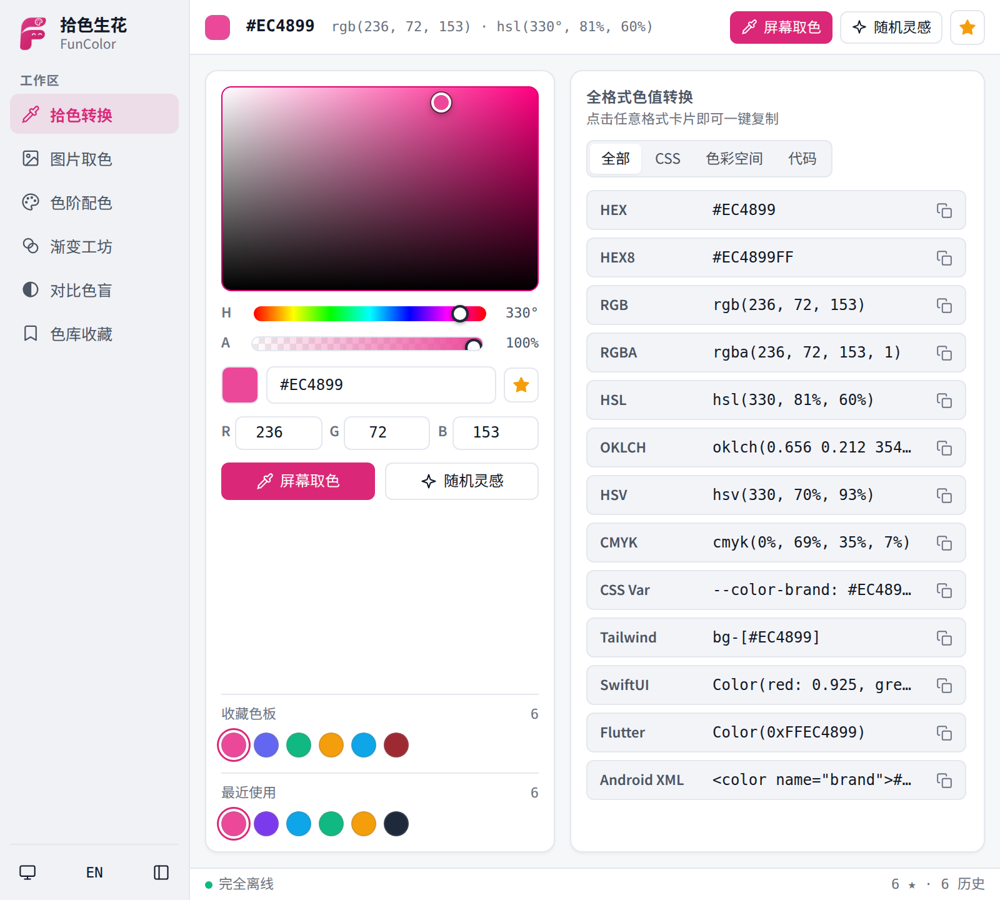
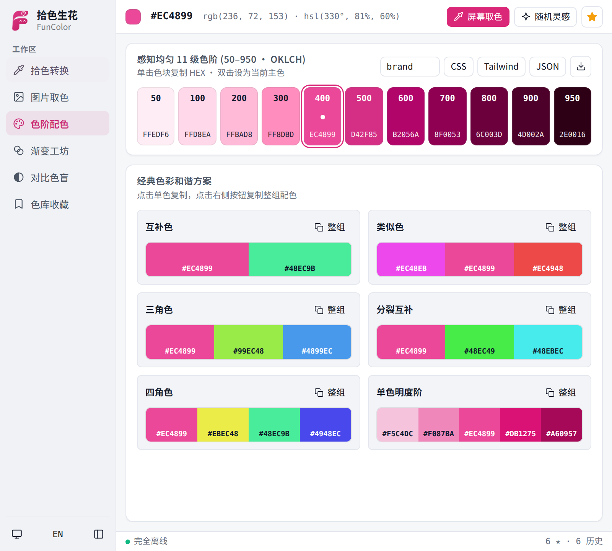
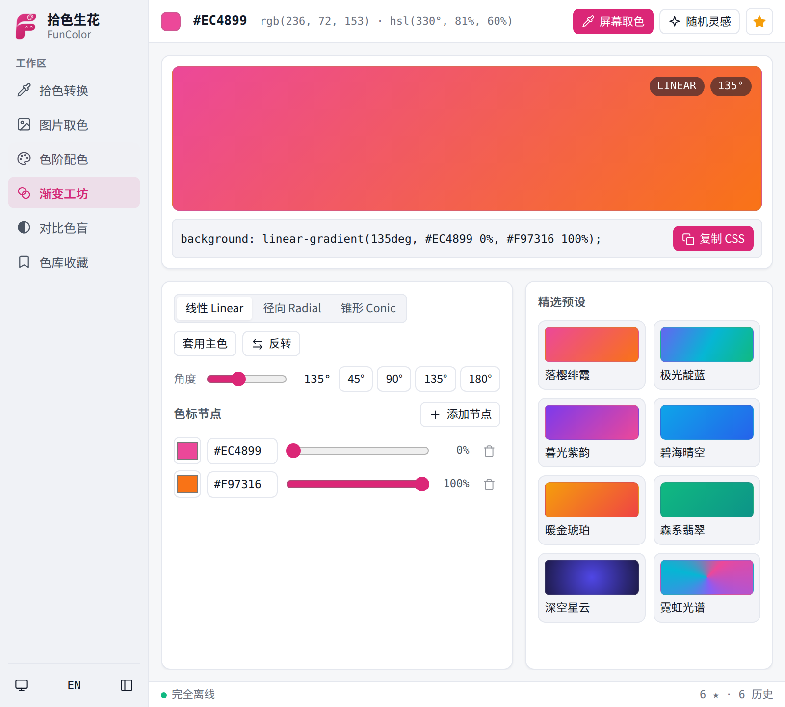
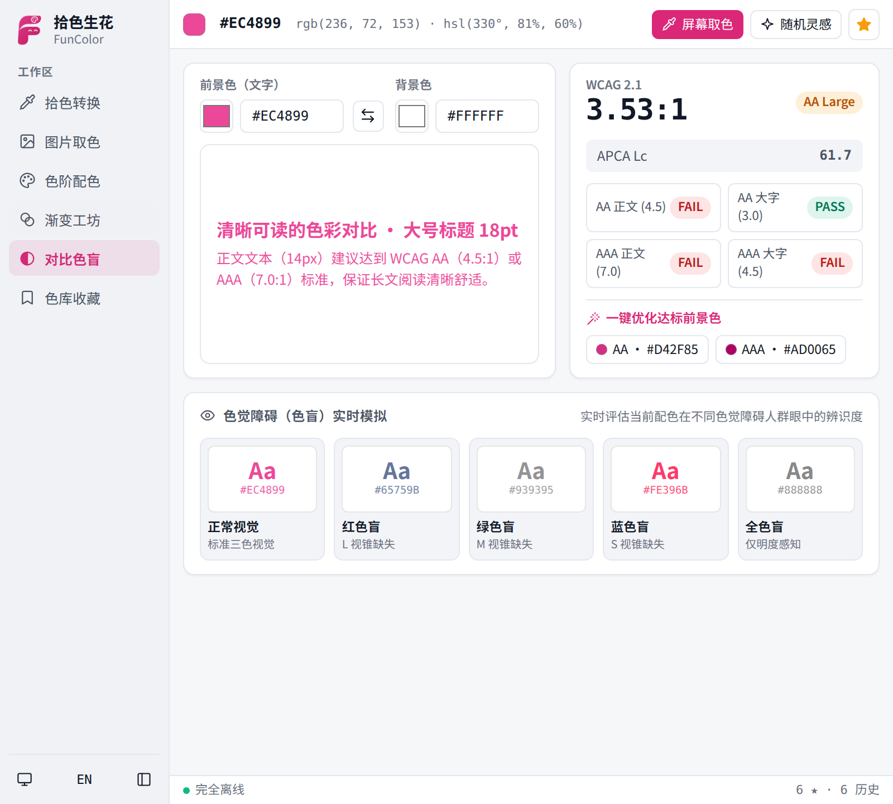
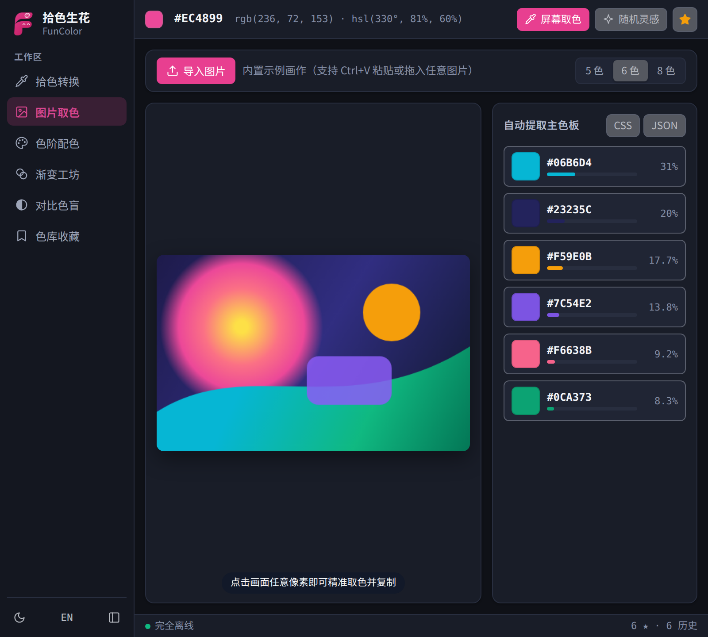

# 拾色生花 · FunColor

<p align="center">
  
</p>

面向设计师与前端工程师的**完全离线**色彩助手与配色工作室（uTools 插件）：支持屏幕吸管取色、图片取色与主色板提取、13 种全格式色值转换、OKLCH 感知均匀 11 级色阶、6 种经典配色和谐方案、CSS 渐变工坊、WCAG 2.1 / APCA 对比度校验与一键达标修复、4 种色盲模拟以及内置中国传统色 / Tailwind / 莫兰迪 / Material 3 色库。

## 功能预览

| 拾色与全格式转换 | 色阶与配色方案 |
| :---: | :---: |
|  |  |

| CSS 渐变工坊 | WCAG 对比度与色盲模拟 |
| :---: | :---: |
|  |  |

| 深色模式 · 图片取色与主色板 |
| :---: |
|  |

## 核心特性

- **拾色转换**：2D HSV 交互式色板、色相 / 透明度滑块、RGB 微调、屏幕吸管（`utools.screenColorPick` / `EyeDropper`）、一键解析与复制 13 种色值格式（`HEX`、`HEX8`、`RGB`、`RGBA`、`HSL`、`OKLCH`、`HSV`、`CMYK`、`CSS Var`、`Tailwind`、`SwiftUI`、`Flutter`、`Android XML`）。
- **图片取色**：拖入、粘贴（`Ctrl/Cmd+V`）或文件打开本地图片，点击画面任意像素精准取色，并离线自动聚类提取主色板与占比，支持导出 CSS / JSON。
- **色阶配色**：基于 OKLCH 感知均匀亮度生成 11 级 Tailwind 风格色阶（`50`–`950`）与 6 种经典和谐配色（互补、类似、三角、分裂互补、四角、单色明度阶），支持 CSS / Tailwind / JSON 导出。
- **渐变工坊**：支持线性 / 径向 / 锥形渐变、角度调节、多色标编辑与反转、8 套精选预设与一键复制 CSS。
- **对比度与色盲模拟**：实时计算 WCAG 2.1 对比度与 `AA`/`AAA` 等级、APCA `Lc` 感知对比度、一键推荐达标前景色，并实时预览红 / 绿 / 蓝 / 全色盲视觉效果。
- **色库收藏**：内置中国传统色、Tailwind CSS、莫兰迪色系、Material 3 离线色库，以及个人收藏夹与历史取色记录。
- **uTools AI / MCP 工具**：内置 `convert_color`、`check_contrast`、`generate_palette` 三个本地离线工具供 uTools AI 直接调用。

## 本地开发与构建

```bash
pnpm install
sh build.sh
```

运行测试与自动截图检查：

```bash
pnpm test
node scripts/screenshots.mjs
```

打包 `.upxs` 发布说明请参考 [docs/release-upxs.md](docs/release-upxs.md)。

## 开源协议

[MIT](LICENSE)
